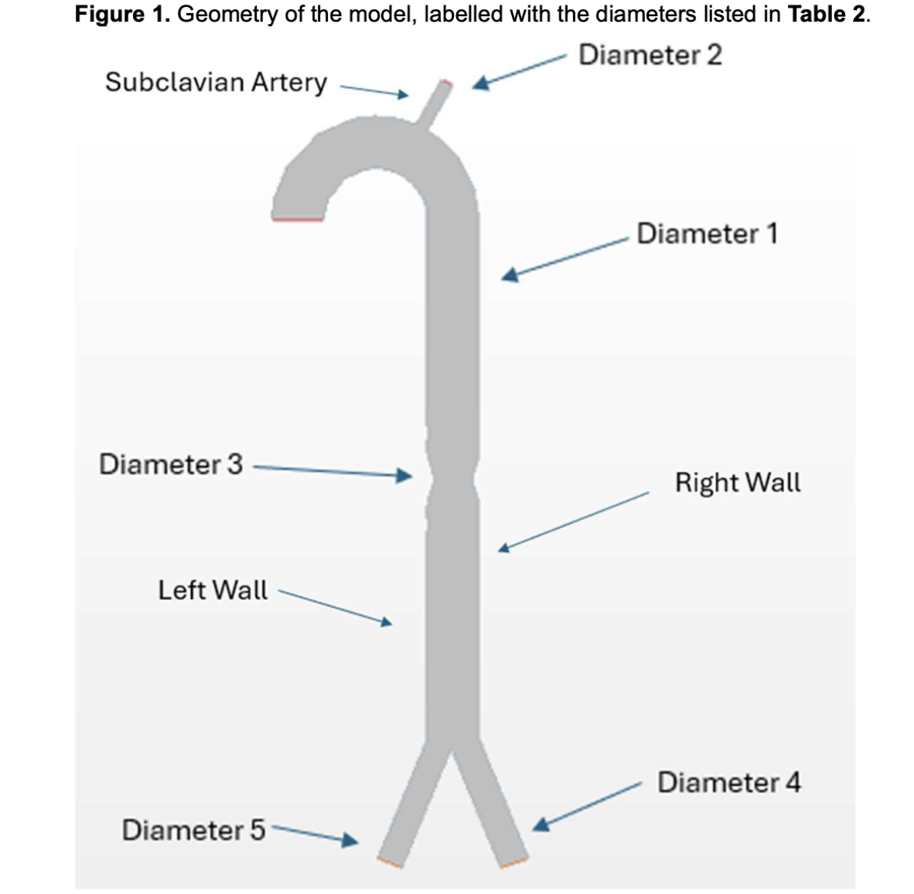
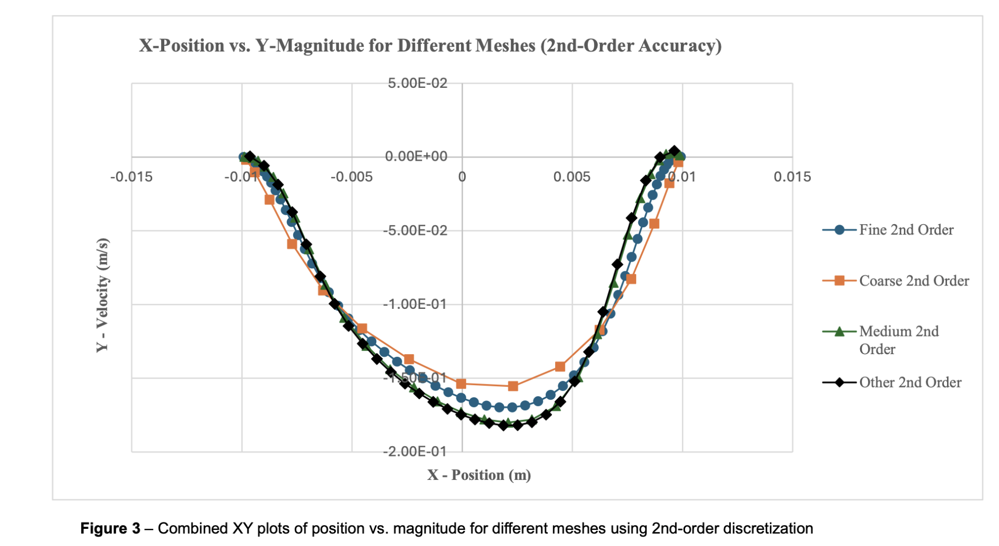

# CFD: Blood Flow Through a Narrowed Aorta

When an artery narrows, blood speeds up through the gap and can separate from the wall just after it, creating backflow and vortices. Can a simulation capture that reliably, and how much does it depend on the mesh?

**Group coursework (team of five) · Simulation Tools in Engineering Analysis and Design · Queen Mary University of London, 2024–25**

## What we did

As a team, we modelled steady, laminar blood flow through a simplified aorta with a stenosis in Simcenter STAR-CCM+. Blood was treated as an incompressible Newtonian fluid (density 1,044 kg/m³) with an inlet velocity of 0.12 m/s. We compared four mesh types (coarse, medium, fine and a mixed "other" mesh), each solved with first-order and second-order discretisation, and analysed the velocity and pressure results in Excel.

## What went wrong

The coarse meshes simply couldn't see the separation points and vortices downstream of the narrowing. First-order schemes were more stable but added artificial viscosity, which smoothed out exactly the backflow we were trying to measure. The mixed mesh converged fastest, but suboptimal grid alignment made it less reliable in the regions with the steepest gradients.

## Results

- Second-order solutions resolved backflow velocities of about **-0.20 m/s**, against about **-0.18 m/s** for first-order.
- The **second-order fine mesh** was the most accurate set-up for capturing velocity gradients, pressure changes and flow separation, at a higher computational cost.

## Tools

Simcenter STAR-CCM+ · Excel

## Files

- [Group report](./cfd-stenosed-aorta-report.pdf) (team members' names and student IDs removed for privacy)
